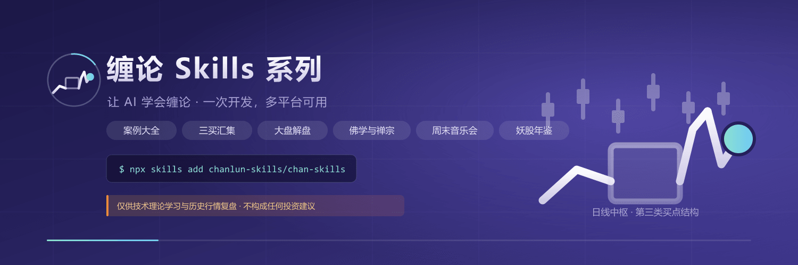

<p align="center">
  
</p>

<p align="center">
  
</p>

<div align="center">

# 缠论 Skills 系列

**让 AI 学会缠论 —— 案例复盘 · 三买汇集 · 大盘解盘 · 佛学与禅宗 · 周末音乐会 · 妖股年鉴**

[](https://github.com/chanlun-skills/chan-skills)
[](https://github.com/chanlun-skills/chan-skills/blob/main/LICENSE)
[](https://github.com/chanlun-skills/chan-skills)

把**缠中说禅**（缠师）的技术分析教学、佛学禅宗专栏、周末音乐连载，以及 37 年 A 股妖股实算数据，
整理成 **6 个可被 AI 直接调用的 Agent Skills**。

[🌐 网页版](https://chanlun-skills.github.io/chan-skills/) · [📦 仓库主页](https://github.com/chanlun-skills/chan-skills) · [💬 加群交流](https://chanlun-skills.github.io/chan-skills/join.html) · [📖 安装使用指南](https://github.com/chanlun-skills/chan-skills)

</div>

---

## 🌐 网页版

**不用懂 GitHub 也能看** —— 项目介绍、六个 Skill 详解、安装命令、真实运行演示、扫码进群，都在网页版里：

**<https://chanlun-skills.github.io/chan-skills/>**


内容随仓库 `main` 分支自动更新。

---

## 这是什么

缠论（缠中说禅）是李彪创立的一套技术分析理论，核心是**用数学结构（分型、笔、中枢、背驰）描述价格走势**。
它的价值在于**结构化、可证伪、可复盘**——这也是它特别适合做成 AI Skill 的原因：能给模型一份可检索的、有明确判断标准的历史语料。

但原始资料的问题也很明显：散落在博客、论坛、108 课里，检索困难，年代久远，多数人不知从何读起。

我做的是把它**结构化**：

```
缠师原文  →  分型/笔/中枢/背驰结构标注  →  按个股/年份/主题索引  →  AI 可调用的 Skill
```

---

## 📦 六个 Skill

| Skill | 内容 | 体量 |
|---|---|---|
| [缠论案例大全](https://github.com/chanlun-skills/chan-skills/tree/main/chanlun-case-library) | 3,026 条历史案例 · 347 只个股 · 六大经典案例深度剖析 | 3.3MB |
| [缠论三买汇集](https://github.com/chanlun-skills/chan-skills/tree/main/chanlun-sanmai) | 20 条日线三买案例（确认13/否认3）· 81 条原话库 · 五步判定链 | 1.3MB |
| [缠论大盘解盘](https://github.com/chanlun-skills/chan-skills/tree/main/chanlun-jiexpan) | 515 篇时间线解盘 · 946 条大盘主题帖 · 6 个关键时段复盘 | 12MB |
| [缠论佛学与禅宗](https://github.com/chanlun-skills/chan-skills/tree/main/chanlun-chan-zen) | 7,131 条语料约 134 万字 · 2,355 条概念索引 · 离线检索站点 | 18MB |
| [缠师周末音乐会](https://github.com/chanlun-skills/chan-skills/tree/main/chanlun-music) | 42 期古典音乐连载全文 · 7,149 条回复 · 77 篇专题 | 5.3MB |
| [妖股年鉴](https://github.com/chanlun-skills/chan-skills/tree/main/chanlun-yaogu) | 1990—2026 共 37 年 444 条妖股明细 · 日线谷→峰实算 · 40 条修正榜 | 6.5MB |

每个 Skill 都是标准目录：`SKILL.md`（触发条件）+ `references/`（结构化语料 + 离线查阅器）+ `scripts/`（零依赖检索工具）。

---

## 🚀 30 秒上手

```bash
# 安装全部 6 个
npx skills add chanlun-skills/chan-skills

# 或只装一个
npx skills add chanlun-skills/chan-skills --skill chanlun-sanmai
```

装完直接提问即可：

- 「缠师当年怎么分析中国联通的？」→ 247 条案例时间线
- 「这位置算不算三买？五步怎么走？」→ 判定链 + 确认/否认双案例对照
- 「2007 年 5 月 30 日缠师怎么判断大盘？」→ 530 当日三来源交叉印证
- 「2015 年最猛的妖股是哪些，实算涨幅多少？」→ 37 年年份卡 + 日线实算

---

## 🧭 我的工作原则

**① 只做历史复盘，不碰当前行情。**
所有 Skill 内置硬性红线：用户问"现在该买什么""今年谁会成妖"，Skill 会明确拒绝。这是设计意图。
缠师的判断窗口是 2002—2008 年，制度环境与今天根本不同，历史结构不可直接映射当下。

**② 数据必须能自证。**
每个 Skill 都带零依赖检索脚本，`python scripts/xxx.py --stats` 立刻能验证库是否完整、条目数是否对得上。
所有涨幅、日期、代码都标注口径与年份。

**③ 纠错比新增重要。**
已采纳的三处订正：北辰实业代码 601588（非流传的 600832）、000803 三卖在 2006 年（不是 2007）、三买涨停名单首行 600068 葛洲坝。
欢迎提 Issue 纠错，我会核实后修正。

**④ 版权分清。**
原创整理部分 CC BY-NC-SA 4.0；缠师原文版权归原作者，仓库仅作索引与学习研究用途；零音频收录。

---

## 📊 数据规模

| | |
|---|---|
| 案例 | 3,026 条 / 347 只个股 |
| 语料 | 7,131 条 / 约 134 万字 |
| 解盘 | 515 篇时间线 + 946 条主题帖 |
| 妖股 | 444 条明细 / 420 组日线 / 37 年 |
| 音乐 | 42 期全文 / 7,149 条回复 |
| 仓库 | 166 文件 / 46MB / 全部离线可用 |

---

## ⚠️ 免责声明

本仓库所有内容仅为**缠论技术理论学习与历史行情复盘**，不构成任何投资建议、证券投资咨询或买卖推荐。
市场有风险，决策需独立判断，风险自担。

---

## 📮 一起做

- **纠错** —— 案例结构划分、代码、年份、涨幅口径有错漏 → 提 Issue
- **补图** —— 录一段你使用 Skill 的演示动图 → PR
- **提需求** —— 想要哪个主题的 Skill → Issue 讨论

---

## 👤 更多内容

**公众号「缠论量化」** —— 缠论文章持续更新，原始资料包免费分享。

- **知乎**：缠论量化 · https://www.zhihu.com/people/chanlunquant
- **缠论资料大全**（夸克网盘 · 免费分享）· https://pan.quark.cn/s/f766d88b7331

[](https://github.com/chanlun-skills)
